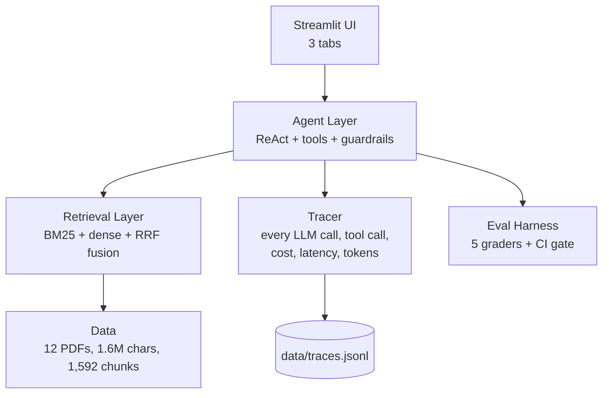

# Claimpilot
**An enterprise-grade AI system for insurance claims triage.**  Grounded RAG over real insurance policy documents · Multi-agent workflow with tools and guardrails · 5-grader eval harness with CI gate · Full observability (traces, cost, latency).

## Architecture

